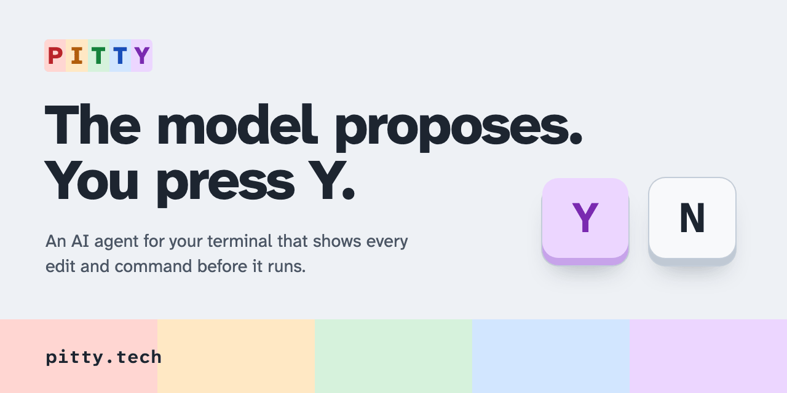
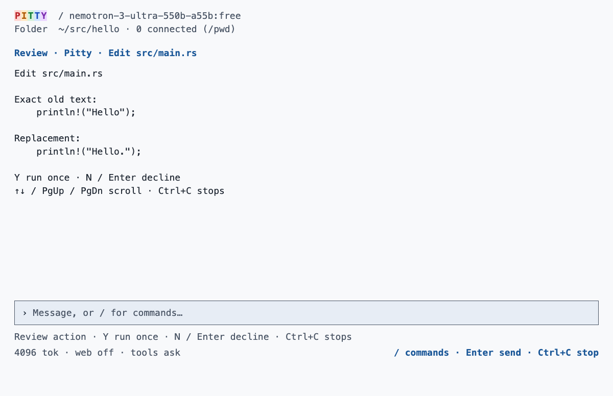

<p align="center">
  <a href="https://pitty.tech"></a>
</p>

<p align="center">
  <a href="https://pitty.tech">Website</a> ·
  <a href="https://pitty.tech/download/">Install</a> ·
  <a href="https://pitty.tech/guide/">Guide</a> ·
  <a href="https://pitty.tech/mcp/">MCP setup</a> ·
  <a href="CHANGELOG.md">Changelog</a> ·
  <a href="SECURITY.md">Security</a>
</p>

# Pitty

Pitty is an AI agent for your terminal. By default, every file change and command it wants to make appears exactly as it will run, and waits for your answer. **Y** runs that one action once. **N**, **Enter**, or **Esc** declines it. What ran, and every decision you made, stays on the record.

Chat goes to the model you choose, in the cloud or on your own computer: OpenRouter by default, OpenAI, a local server such as Ollama or LM Studio (`/local`), or any compatible endpoint. Every model can search the web, and the sources are listed under the answer. When you trust the task, press **A** at a review or **Shift+Tab** to switch to Auto, and the work keeps going without stopping. Pitty can also lend the same file and command tools to an MCP client such as Claude Code or Codex. It is written in Rust, runs on macOS and Linux, and is free and open source under the MIT License.

<p align="center">
  
</p>

## What it checks before anything lands

These are quoted as Pitty prints them.

| Pitty says | What it means |
| --- | --- |
| `Y run once · A approve all · N / Enter decline` | Ask is the mode Pitty starts in. File changes, commands, web requests, and reads of credential-like files wait on screen. Y approves that one action; A approves it and switches to Auto for the rest of the session. |
| `File changed after approval; prepare the edit again.` | Writes are checked against the version you reviewed. If the file changed after you said yes, the write does not land. |
| `This path may contain credentials; approved contents will be sent to the model.` | Files such as `.env` and SSH keys need their own approval, and search skips them. Over MCP they are never read. |
| `Only a small set of nonsecret environment variables is inherited.` | Commands the model asks for start from a cleared environment, so `OPENROUTER_API_KEY`, `OPENAI_API_KEY`, and `PITTY_API_KEY` stay out. They still run with your account's permissions. |

`/actions` lists what ran in the conversation and its output. `/audit` checks the decision log: each approval, decline, and run appends a line that stores the SHA-256 of the line before it, so an edited or deleted line breaks the chain. The log records decisions, never file contents or command output, and it stays on your computer.

Pitty has no account and no telemetry. It contacts the chat endpoint you choose; when web search is on, the search provider you choose and the pages the model reads; and other Pitty terminals only when you open a `/peer` room.

## Install

Open [pitty.tech/download](https://pitty.tech/download/) and paste one block into your terminal. It downloads the archive for your computer, verifies its SHA-256 checksum before unpacking, checks that the program runs, installs it to `~/.local/bin/pitty`, and opens it. No administrator password or Rust toolchain is needed. The same archives are attached to each [GitHub release](https://github.com/RuptionAI/pitty/releases).

| Your computer | Archive |
| --- | --- |
| Mac with Apple silicon, macOS 11 or later | `pitty-VERSION-aarch64-apple-darwin.tar.gz` |
| Mac with Intel, macOS 11 or later | `pitty-VERSION-x86_64-apple-darwin.tar.gz` |
| 64-bit Intel or AMD Linux, glibc 2.35 or later | `pitty-VERSION-x86_64-unknown-linux-gnu.tar.gz` |

macOS builds are not yet signed with an Apple Developer ID or notarized. Native Windows is not supported. [INSTALL.md](INSTALL.md) covers manual installation, checksums, and removal.

To build from source instead, use Rust 1.98 or newer:

```sh
cargo install --git https://github.com/RuptionAI/pitty --locked pitty
```

The compiled WebAssembly engine is committed in `assets/`, so a source install needs no browser, Node.js, or separate Wasm runtime. Make sure `~/.cargo/bin` is on your PATH.

## Quick start

```sh
pitty --directory /path/to/project
```

Type `/key` and paste your OpenRouter API key into the masked field; it is saved on your computer with owner-only permissions. Then choose a model and ask for something:

```text
/models free           Browse free models in OpenRouter's live catalog
/model 3               Pick a model from that list
Add a period to the greeting in src/main.rs.
```

The change appears as exact old text and its replacement. Press **Y** to write it once, or **N** to decline. `/help` lists every command, and typing `/` opens the command menu.

### Models on your own computer

Start a local model server, such as Ollama (`ollama serve`, then `ollama pull qwen3:4b`) or the local server in LM Studio, then:

```sh
pitty --local
```

Inside Pitty, `/local` does the same: it finds Ollama, LM Studio, llama.cpp, vLLM, Jan, GPT4All, and Docker Model Runner on their usual ports (and Ollama at `OLLAMA_HOST`), lists every model they serve, and switches chat to the one you choose. Chat stays on your machine and needs no key. Pitty does not run models itself; it talks to the server you already use. A model needs function calling to use the file tools (Qwen 3 and Llama 3.1 or later do); for a chat-only model, type `/tools off`. Reasoning models such as Qwen 3 think before they answer, and the thinking counts against the output limit: if a reply comes back empty, raise it with `/tokens 8000`.

### Other cloud models

```sh
pitty --interface openai --model gpt-4.1-mini
pitty --interface compatible --base-url http://127.0.0.1:11434/v1 --model llama3.2
```

OpenAI reads `OPENAI_API_KEY`. A compatible endpoint reads `PITTY_API_KEY` when you set one and sends no Authorization header when you do not. Inside Pitty, `/interface` shows or changes the choice and starts a new conversation, and `/models` lists the models of the interface you are on. PDF parsing and `/models free` belong to OpenRouter. Local tools need a model that supports function calling; use `/tools off` for a chat-only model.

### As an MCP server

```sh
claude mcp add pitty -- "$HOME/.local/bin/pitty" --mcp --directory "$PWD" --tools ask
```

Pitty speaks MCP over standard input and output and uses the client's model, so this mode needs no chat key. `--tools ask` exposes read-only tools, because standard input carries the protocol and cannot show a Y/N prompt; `--tools auto` adds file changes and commands, so set up confirmation in your client. Credential-like files are never read over MCP. Any client that reads a JSON configuration can use:

```json
{
  "mcpServers": {
    "pitty": {
      "command": "/absolute/path/to/pitty",
      "args": ["--mcp", "--directory", "/absolute/path/to/project", "--tools", "ask"]
    }
  }
}
```

See [pitty.tech/mcp](https://pitty.tech/mcp/) for Codex, Cursor, and VS Code.

## Work with files and commands

Ask Pitty to inspect a file, make a change, and run the tests. Local tools can list and search files, read text, create or overwrite files, replace exact text, and run commands. The model receives each result and keeps working on the task.

```text
/run cargo test
/exec python3 scripts/check.py
/actions
/audit
```

`/run` and `/exec` execute the command you typed directly, without a model request or API key, in the working folder. `/tools off` disables model tools. The matching command-line option is `--tools ask|auto|off`.

### Ask and Auto

`/tools ask` is the default: each file change, command, web request, and credential-like read waits for your answer. At a review, **Y** runs that action once, **N**, **Enter**, or **Esc** declines it, and **A** approves it (and any other review already waiting) and switches the session to Auto.

In Auto (`/tools auto`, **A**, or **Shift+Tab**), actions run without review, including work that is already running, and a long task keeps going until it finishes. **Shift+Tab** switches back to Ask at any time, and the next action waits again. Every action is still recorded in `/actions` and the decision log, and Ctrl+C stops everything.

One request may use up to 100 model turns (`/turns N` or `--max-turns N`, up to 1000). In Ask, a long task checks in every 16 turns: **Y** continues, **A** continues in Auto, and **N** stops with the work done so far. Each model turn goes to your provider and may cost money, so the limit is also a spending guard.

File tools operate inside the working folder and connected folders and reject symlink traversal. Commands run with your account's permissions and can reach resources beyond the working folder; this is an approval boundary, not an operating-system sandbox. Commands get noninteractive input, bounded output, and a timeout, and Ctrl+C cancels the whole process group. Stopping a request keeps completed work in the conversation. `/retry` never repeats a turn that already performed local actions.

## Keyboard controls

| Key | Action |
| --- | --- |
| Enter | Send a message or run a command |
| Ctrl+J or Alt+Enter | Insert a new line (Alt+Enter needs "Use Option as Meta key" in macOS Terminal) |
| `/` | Open the command menu |
| Up / Down | Scroll the transcript when the composer is empty; select in a picker or command menu |
| Tab | Complete the selected command; browse history when the composer is empty |
| Mouse wheel / trackpad over chat | Scroll the conversation while the composer, status, and footer stay fixed |
| Page Up / Page Down | Scroll one visible page, including while editing a draft |
| Ctrl+U | Clear the draft |
| Ctrl+K | Delete to the end of the line |
| Ctrl+L | Redraw the whole screen |
| Drag over chat text | Select text; click **Copy selection** to copy it |
| Ctrl+Y | Copy selected text, or the entire latest assistant reply when nothing is selected |
| F2 or `/select` | Enter native terminal text selection; F2, Enter, or Esc returns |
| Esc | Clear a text selection first; otherwise close a panel, cancel ASCII art, hide the peer room, or clear the draft |
| Ctrl+C | Stop an active request and restore its draft; otherwise clear the entire draft and staged files |
| Ctrl+C again | Ask whether to close the session |
| Ctrl+Q or `/quit` | Ask whether to close the session |
| Shift+Tab | Switch tools between Ask and Auto |
| A at a review | Approve this action and the rest; switch to Auto |

Closing requires **Y**; Enter, N, or Esc keeps the session open. Cancellation drops the local HTTP operation; a provider may already have started processing it.

Bracketed paste inserts multiline text without sending it. Selection highlights the text and keeps that view still while replies finish in the background; typing, scrolling, or resizing returns to the live conversation. Selected code omits display borders and preserves source tabs and real line breaks. Mouse reporting is on by default so the wheel scrolls the chat pane; `/mouse off` (or `pitty --no-mouse`) returns native terminal selection. `/copy` uses the system clipboard; Linux needs `wl-copy` or `xclip`.

## Slash commands

| Command | Purpose |
| --- | --- |
| `/help` | Commands and keyboard reference |
| `/tools [ask or auto or off]` | Choose how model file tools and commands run; Shift+Tab switches ask and auto |
| `/turns [NUMBER]` | Show or set how many model turns one request may use |
| `/run COMMAND`, `/exec COMMAND` | Run a command or program directly |
| `/actions` | Review local actions and their output |
| `/audit` | Check the decision log |
| `/new` | New conversation |
| `/chats`, `/open NUMBER` | Browse and open saved conversations |
| `/rename TITLE` | Rename the current conversation |
| `/delete confirm`, `/clear confirm` | Delete or clear the current conversation |
| `/copy` | Search messages and code blocks, preview, then Enter to copy |
| `/copy last`, `/copy chat` | Copy the latest reply or entire conversation |
| `/copy message N`, `/copy code N` | Copy a specific message or code block |
| `/copy draft` | Copy the most recently submitted prompt |
| `/export PATH.md` | Export Markdown; never overwrite an existing file |
| `/save`, `/history on`, `/history off` | Control local history saving |
| `/interface [openrouter or openai or local or compatible URL]` | Show or change where chat goes |
| `/local` | Find model servers on this computer and choose a local model |
| `/models [free or search text]` | List the models of this interface; OpenRouter's catalog includes free models |
| `/model [ID or number]` | Show or select the model |
| `/key` | Masked API key entry |
| `/name [NAME]`, `/team [NAME or off]` | Save local display labels |
| `/peer`, `/peer host`, `/peer join ROOM` | Chat with another Pitty. Rooms are numbers. No server and no database |
| `/peer art`, `/peer move`, `/peer pick N`, `/peer leave` | Share ASCII art, move it, and leave the room |
| `/pwd` | Full working directory and connected folder paths |
| `/agent NAME TASK` | Launch a named parallel task using the current model |
| `/agent NAME --model ID TASK` | Launch a task with a different model |
| `/agents`, `/agent open ID` | See task progress and open a completed result |
| `/agent stop ID`, `/agent stop all` | Cancel background agent requests |
| `/select` | Toggle native text selection without losing the draft |
| `/web [on or off]` | Toggle web search; off at startup |
| `/web duckduckgo`, `/web searxng URL`, `/web brave`, `/web tavily`, `/web openrouter` | Choose where searches go |
| `/attach PATH…` | Stage local files for the next message |
| `/attachments`, `/detach NUMBER`, `/detach all` | Review or remove staged files |
| `/connect PATH…`, `/folders` | Remember and list local or mounted network folders |
| `/files [NUMBER]` | Browse folders, filter filenames, and stage selected files |
| `/disconnect NUMBER` | Forget a folder connection without changing its files |
| `/tokens [NUMBER]` | Show or set the output token cap |
| `/timeout [SECONDS]` | Show or set the timeout (up to 3600 seconds) |
| `/system [PROMPT or off]` | Show, set, or clear the system instruction |
| `/status` | Current model, settings, and history location |
| `/theme auto`, `/theme light`, `/theme dark` | Terminal-native or explicit high-contrast palettes |
| `/sidebar show`, `/sidebar hide` | Optional conversation sidebar on wide terminals |
| `/mouse on`, `/mouse off` | In-app wheel scrolling or native terminal selection |
| `/compact on`, `/compact off` | Message spacing |
| `/top`, `/bottom` | Jump through the transcript |
| `/search WORDS` | Search this conversation |
| `/retry` | Retry the last prompt when it has no completed local actions |
| `/quit` | Request closing the session |

Slash commands are never sent as model prompts. Use `//` to send a message that begins with a literal `/`. A `/peer` room connects Pitty terminals directly: one person hosts, others join that room number, and the room ends when the host leaves. Messages and ASCII art stay in those terminals. Rooms have no password or encryption, so anyone on your local network can join one while it is open; host them only on networks you trust.

## Parallel tasks

```text
/agent planner Break this project into milestones and dependencies.
/agent researcher --model openrouter/free Identify assumptions worth checking.
/agents
/agent open 1
```

Agents receive a snapshot of the conversation, including attachments, plus their task, and share the local tool policy and review queue. At most four inference requests run at once, including the main chat. Handoffs are explicit: open a finished result before launching the next task. Each request can incur charges, so set a spending limit on your key.

## Attachments and connected folders

Use `/attach PATH`, drag files into the terminal, or browse with `/connect` and `/files`. Staged files are listed above the composer, and Enter sends them with your next prompt. Images, native PDFs, common audio and video formats, and UTF-8 text are accepted when the selected model and provider support them. Defaults are 16 MiB per binary file, 2 MiB per text file, and 28 MiB per serialized conversation; adjust them with `PITTY_MAX_FILE_MIB` (1–64), `PITTY_MAX_TEXT_MIB` (1–16), and `PITTY_MAX_CHAT_MIB` (1–80).

Connecting and browsing a folder upload nothing. Choosing a file snapshots it into the attachment list, and sending a message uploads those snapshots. Connections are remembered in `$XDG_CONFIG_HOME/pitty/folders.json` with owner-only permissions; `/disconnect` forgets one without touching its files. Network drives must already be mounted by your operating system.

## Web search

`/web on` lets the model search for later messages and `/web off` stops it; the footer always shows the state. Every model can search, local ones included:

| Provider | Choose it with | Needs |
| --- | --- | --- |
| DuckDuckGo | `/web duckduckgo`, `--search duckduckgo` | Nothing. Pitty reads DuckDuckGo's HTML results page |
| SearXNG | `/web searxng URL`, `--search-url URL`, or `PITTY_SEARXNG_URL` | Your own instance with JSON output enabled |
| Brave Search | `/web brave` | `BRAVE_SEARCH_API_KEY` |
| Tavily | `/web tavily` | `TAVILY_API_KEY` |
| OpenRouter hosted search | `/web openrouter` | The OpenRouter interface |

Without a choice, OpenRouter uses its [hosted search](https://openrouter.ai/docs/guides/features/server-tools/web-search) (at most one search and three results per request), and every other interface uses the first one configured of SearXNG, Brave, and Tavily, then DuckDuckGo. `PITTY_SEARCH` sets a default. Keys are read from the environment or from `~/.config/pitty/.env`.

With Pitty's own search, the model gets two tools: `web_search`, which returns numbered results, and `web_fetch`, which reads one page as text. The URLs it searched and read are listed under the answer. In Ask mode, each search and fetch shows for review first, with the query or address and where it goes, because a model can put anything it has read into a query. `web_fetch` reaches only public internet addresses: it refuses loopback, private, link-local, and other reserved ranges, checks every redirect the same way, and pins the address it checked. Web content reaches the model as untrusted text. With `/tools off`, Pitty searches your message before sending it and passes the results along, so models without function calling can use the web too. Paid providers can add charges.

## One-shot mode

```sh
pitty "Explain Rust ownership"
cat src/main.rs | pitty "Review this code"
pitty --json "Say hello"
pitty --no-history
```

The default model is `nvidia/nemotron-3-ultra-550b-a55b:free`, with a 4096-token output cap and a 180-second timeout per request. A tool-enabled request makes up to 100 model requests (`--max-turns`), with up to eight tool calls per batch. In one-shot mode, reviews appear on the terminal: type `yes` to allow one action, `all` to allow it and the rest of the request, or press Enter to decline. Replies appear when generation completes; token streaming is not implemented. Requests are never retried automatically or switched to another model. `pitty --local "Say hello"` asks a model on this computer.

## Storage and privacy

The key is read from an explicit `--key-file`, then `OPENROUTER_API_KEY`, then `$XDG_CONFIG_HOME/pitty/.env` (default `~/.config/pitty/.env`). Search keys (`BRAVE_SEARCH_API_KEY`, `TAVILY_API_KEY`) are read from the environment, then the same file. Keys never enter prompts or saved conversations.

Conversations are saved as owner-readable JSON under `$XDG_DATA_HOME/pitty/chats` (default `~/.local/share/pitty/chats`). History is plain text, not encrypted, and includes attachment snapshots, completed tool traces, and the action ledger. `--no-history` neither loads nor saves chats. The decision log is `$XDG_DATA_HOME/pitty/audit.log`.

Sending a message sends its conversation to the chat endpoint you chose; provider privacy and retention terms vary. Pitty filters terminal control sequences from rendered content so model output cannot issue terminal commands.

## How it is built

Everything is Rust. The terminal interface is Pitty's own library with no dependencies: it implements its renderer, editor, Unicode-aware layout, input decoder, and bracketed paste handling with the standard library. The application uses established crates for HTTPS, TLS, JSON, command-line parsing, and WebAssembly execution. Command parsing and conversation validation run as a WebAssembly engine inside the binary, under Wasmi, with no filesystem or network imports.

```text
src/main.rs                   Command line and credential loading
src/interface.rs              Where a chat turn is sent
src/local.rs                  Finding model servers on this computer
src/chat.rs                   Requests, the tool loop, Ask and Auto, and check-ins
src/web.rs                    Web search providers and safe page fetching
src/local_tools.rs            File and command tools, the review, and stale-edit checks
src/mcp.rs                    The MCP server over standard input and output
src/audit.rs                  The hash-chained decision log behind /audit
src/audit_cert.rs             Decision rules annotated for the LeanRust prover
src/agents.rs                 Bounded parallel requests and cancellation
src/peer.rs                   Rooms between Pitty terminals
src/signals.rs                Termination signals for every mode
src/attachments.rs            File staging and multimodal content
src/folders.rs                Saved connections and bounded directory listings
src/tui.rs, src/tui/          Layout, review, transcript, folder browser, selection
crates/pitty/                 The terminal interface library, with no dependencies
crates/core/                  Command parsing and conversation validation, built to Wasm
crates/leanrust*/             Attribute markers for the LeanRust prover; they compile away
assets/pitty_core.wasm        The compiled engine, embedded into the binary
tools/build/                  Builds the engine and binary, packages, and installs
tools/release/                Packages a built binary with notices and a checksum
site/                         Rust source for pitty.tech
website/                      The generated site
```

Build and check everything:

```sh
rustup target add wasm32-unknown-unknown
cargo run -p pitty-build -- release
cargo fmt --all --check
cargo clippy --locked --workspace --all-targets -- -D warnings
cargo test --locked --workspace
```

`cargo run --locked -p pitty-build -- install` builds a release for this computer, packages an archive (in `target/dist`, or `PITTY_ARCHIVE_DIR` when set), installs `~/.local/bin/pitty`, and checks the website. Release archives for all three platforms come from the **Release packages** workflow on GitHub. Tests use local data and never make inference requests. See [CONTRIBUTING.md](CONTRIBUTING.md).

## The website

[pitty.tech](https://pitty.tech) is built from Rust too. `site/builder` renders every page, the Apache configuration, `robots.txt`, `sitemap.xml`, and the 404 page, and fingerprints every asset. `site/browser` is compiled to WebAssembly and runs the copy buttons and the keyboard for the home page demo; the only JavaScript served is the binding module wasm-bindgen generates from it. The pages work without it. Type is Atkinson Hyperlegible Next and Mono, self-hosted under the SIL Open Font License.

```sh
cargo run --manifest-path site/Cargo.toml -p pitty-site -- build   # compile the Wasm, render website/
cargo run --manifest-path site/Cargo.toml -p pitty-site -- pages   # re-render pages only
cargo run --manifest-path site/Cargo.toml -p pitty-site -- check   # fail if website/ is stale
cargo run --manifest-path site/Cargo.toml -p pitty-site -- serve   # preview at 127.0.0.1:8000
```

Every build checks that ids are unique, every label and copy button has a target, and every internal link and anchor resolves. CI runs `check`, so `website/` cannot drift from its source.

## Known limits

Replies are not streamed, the Markdown renderer is lightweight, Unicode display widths are approximate, local history is plaintext, and agent handoffs are manual. Local commands run with your account's permissions; the review is the control for authorizing them. macOS builds are not notarized, and native Windows is not supported.

## License

[MIT](LICENSE). Pitty is made by [Ruption AI, Inc.](https://ruption.ai) and is independent of OpenRouter, OpenAI, and model providers. The typefaces on pitty.tech are licensed under the [SIL Open Font License](site/static/fonts/OFL-atkinson-hyperlegible-next.txt).
